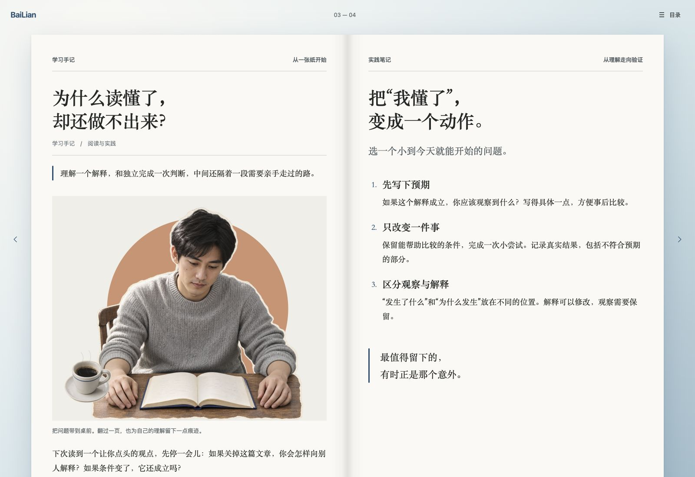

# Editorial Magazine

**从编辑命题、艺术指导到元素级动画，制作有完整设计语言的电子杂志。**

这是一套可以直接执行的设计 skill。规范完整写在仓库内，覆盖整期组织、跨页构图、中文排版、摄影拼贴、点阵视觉、阅读器与导出，不依赖外部作品链接才能理解。

BaiLian 是随附样刊的品牌。技能也可用于其他品牌；遵循用户命名，不自动设定出版周期。




以上是可运行样刊的静态截图；书叶、咖啡、蒸汽与翻页过渡在网页中独立运行。

## 能做什么

- **整期编辑**：选题、内容保留、编辑命题、栏目责任、页面地图和疏密节奏。
- **艺术指导**：视觉命题、颜色角色、中文与拉丁字体、网格、光学平衡、纸张与细线。
- **25 类模块**：封面、目录、专题、正文、旁注、图表、代码、页脚、纸面翻页、放大、加载等。
- **视觉资产**：静止构图、局部着色、抠图、纸边、光向、透明图层、素材清单与生成任务配方。
- **内容动效**：对象各自的锚点、幅度、周期、相位；点阵造型；机制分步；自动停止与生命周期。
- **真实阅读**：大屏双页、小屏重排、纸面点击、两侧箭头、目录、深链接、焦点、静帧和按需打印。
- **质量审校**：整期接触表、正常阅读、放大细节、动态实测、事实完整性和发布检查。

## 安装

Codex 新安装示例（目标目录已经存在时先保留已有版本，不覆盖个人修改）：

```sh
git clone https://github.com/Lingbo-Huang/editorial-magazine-skill.git ~/.codex/skills/editorial-magazine
```

其他兼容 `SKILL.md` 的工具，将仓库放入其技能目录。重新载入技能或开始新会话后调用：

```text
使用 $editorial-magazine，把这些内容编成一期 BaiLian 专题杂志。
保留原文实质内容；以纸质拼贴与理性技术图形建立视觉语言。
先确定编辑命题、艺术指导和页面节奏，再完成内部元素独立运动的配图。
交付可编辑 HTML 和真实的检查记录，不预设固定出版周期。
```

仅做静态作品时说明无需动态；若需要 PDF，明确要求实际导出并逐页检查。

## 文档导航

| 文档 | 解决的问题 |
|---|---|
| [SKILL.md](SKILL.md) | 执行流程、边界与规范入口 |
| [设计解剖](references/design-anatomy.md) | 为什么纸面、拼贴、技术跨页和阅读框架成立 |
| [艺术指导](references/art-direction.md) | 把审美转成字体、颜色、比例、网格和材料规则 |
| [整期组织](references/editorial-recipes.md) | 编选、阅读弧线、跨页关系、密度和分页 |
| [模块规格](references/component-specs.md) | 25 类模块的组成、位置、状态和细节 |
| [视觉资产](references/visual-assets.md) | 摄影拼贴、透明图层、裁切、纸边与技术视觉 |
| [动态编排](references/motion-recipes.md) | 逐层运动表、Canvas、生命周期与验收 |
| [阅读器](references/reader-contract.md) | 响应式、导航、键盘、打印与资源管理 |
| [纸书交互](references/book-interaction.md) | 整页封面、悬停、书中翻页、双面纸叶过渡与点击保护 |
| [质量门槛](references/quality-gates.md) | 艺术审校、硬性条件和实测记录 |
| [方法提炼](references/study-lessons.md) | 从出版、封面、布局等不同工序中吸收什么 |
| [BaiLian 项目适配](references/dandan-learn.md) | 在既有内容网站中保持品牌与权限边界 |

[工作模板](assets/templates/) 包含 issue brief、页面地图和逐层动效清单。

## 运行原创机制示例

```sh
python3 -m http.server 4179 --bind 127.0.0.1 --directory assets/starter
```

在浏览器打开 `http://127.0.0.1:4179/`。也可以直接打开 [index.html](assets/starter/index.html)。不需要第三方前端运行依赖。

样刊共 7 个页面单元。封面为生成的摄影拼贴：男生坐在桌前阅读，书中的纸叶分别翻动，咖啡杯与蒸汽独立运动。鼠标悬停封面有轻微的空间反馈，点击整张封面即可翻开刊首语。

内页为宽幅纸书：箭头位于纸张两侧，点击左右纸面也能翻页，并有双面纸叶绕书脊转动的过渡。只保留简洁目录入口，没有独立进入按钮、动态暂停、连续阅读或主题/阅读模式切换按钮。大屏自动双页，小屏自动单页；离屏、后台、目录覆盖和系统减少动态时自动停止相应动画。

素材原图、生成提示词与图层坐标见 [素材记录](assets/starter/media/ASSETS.md)。图片保留透明通道；真实文字、摄影主组、书叶、咖啡、蒸汽与 Canvas 点阵分别实现。

本次在桌面 1440/1600px 与手机 390px 视口检查了封面点击/键盘打开、左右纸面与侧边箭头、目录跳转、浏览器返回、快速翻页清理、双击选字和清除选区。书叶、咖啡和蒸汽的计算样式分别变化；离页及目录覆盖自动停动。手机正文没有横向溢出，浏览器错误日志为空。

生产验收要求见规范，不能将样刊等同于完整长刊引擎。后台资源测量、系统减少动态切换、无脚本运行、200% 文字放大和 PDF 逐页输出仍需按实际环境验收；没有实际导出的 PDF 不列为交付物。

## 设计原则

先理解内容，再设计整期；先成立静帧，再加入运动。标题和必要文字保持稳定，图像内部按有意义的对象编舞。不同页面有不同责任，重复的是身份与网格，变化的是图文关系和密度。

只交付真实完成的内容：不编造署名、来源或实验结果，不以动态粒子冒充科学证据，不把参考作品的内部素材加入分发。具体作品的图片、字体与内容需要单独确认使用范围。

## 许可

本仓库原创说明、代码、模板和示例使用 [MIT License](LICENSE)。附带摄影素材由内置 imagegen 为本项目生成；不包含第三方原刊的正文、照片、截图、签名或字体文件。MIT 许可不授予任何第三方素材或品牌的使用权。
